<div align="center">


# TaskTrail

**Every property task, done right and proven.**

Recurring operations tasks for co-living properties, from the daily checklist to a reviewed, audited close, with every step on record.

[Live demo](https://zo-task.vercel.app) · [Product tour](#product-tour) · [How it works](#how-it-works) · [Getting started](#getting-started) · [Architecture](#architecture)


<br />

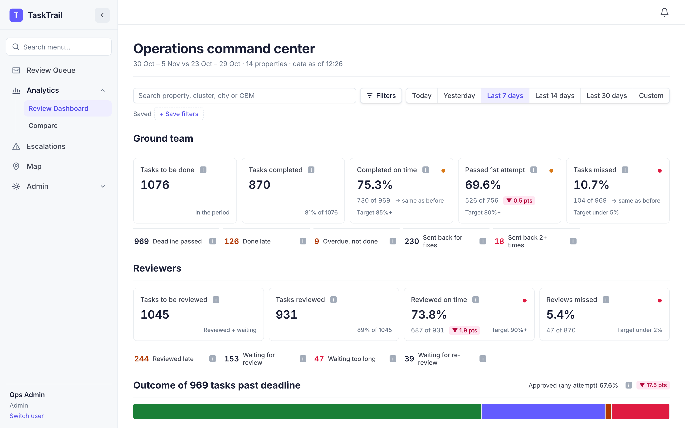

<sub>The operations command center, running on the built-in sample data.</sub>

</div>

<br />

> [!NOTE]
> TaskTrail is a **working prototype**. Sign-in is a role picker with no password, notifications are in-app only, and it ships with sample data. See [Known limitations](#known-limitations) before using it for real work.

## Contents

- [Why TaskTrail](#why-tasktrail)
- [Product tour](#product-tour)
- [Key features](#key-features)
- [How it works](#how-it-works)
- [Dashboards and reporting](#dashboards-and-reporting)
- [Roles and permissions](#roles-and-permissions)
- [Tech stack](#tech-stack)
- [Architecture](#architecture)
- [Getting started](#getting-started)
- [Deployment](#deployment)
- [Project structure](#project-structure)
- [Testing](#testing)
- [Known limitations](#known-limitations)
- [Roadmap](#roadmap)

## Why TaskTrail

Property teams run the same checks every day: housekeeping attendance, water supply, room readiness, lift and garbage, resident meetings. A spreadsheet or chat group can tell you a task was *marked* done. It can't tell you whether it was done *properly*, who checked it, or why it came back.

TaskTrail is built around a **maker-checker** loop:

| | A basic task list | TaskTrail |
|---|---|---|
| **Proof** | A tick in a cell | Per-item answers, photos, notes and a location check |
| **Verification** | None, or ad hoc | A central reviewer passes or flags every item, with a reason |
| **Second check** | None | An auditor re-checks a configurable sample of passed tasks |
| **Rework** | Invisible | Attempts are counted, and old and new answers sit side by side |
| **Blockers** | Lost in mail and sheets | Escalations with an owner, a due date and a status |
| **Visibility** | Manual roll-ups | Live dashboards where every number opens the tasks behind it |

It is designed for **cluster business managers (CBMs)** and ground teams who do the work, **central reviewers** and **auditors** who check it, and **operations leadership** who need to see where work is stuck.

## Product tour

<table>
  <tr>
    <td width="50%" valign="top">
      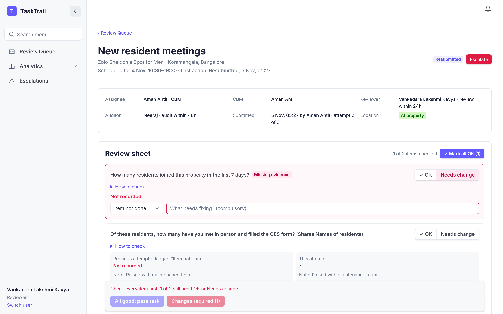
      <p><b>Review sheet</b><br /><sub>The reviewer marks every item OK or Needs change, with a reason. Previous and current attempts sit side by side, and missing evidence blocks a pass.</sub></p>
    </td>
    <td width="50%" valign="top">
      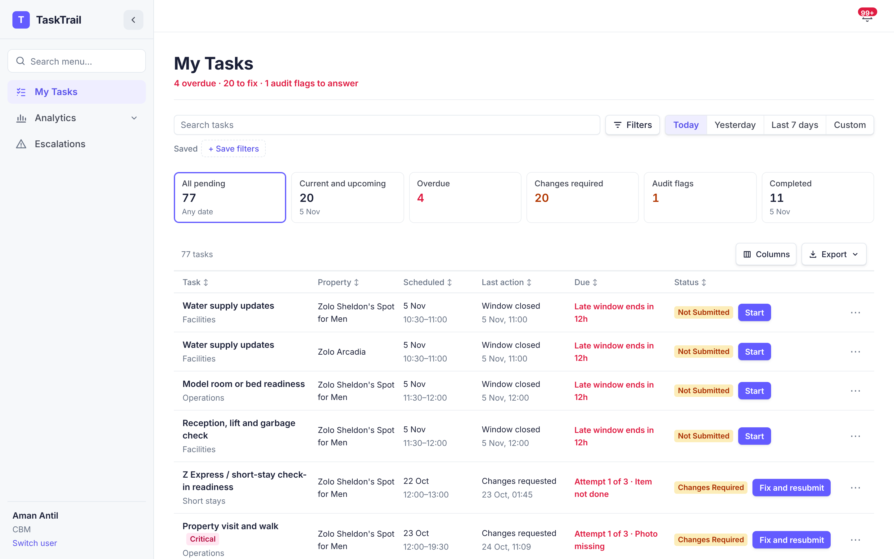
      <p><b>My Tasks</b><br /><sub>A CBM's day in one list: what is due, overdue, sent back or flagged in audit, scoped to their own properties.</sub></p>
    </td>
  </tr>
  <tr>
    <td width="50%" valign="top">
      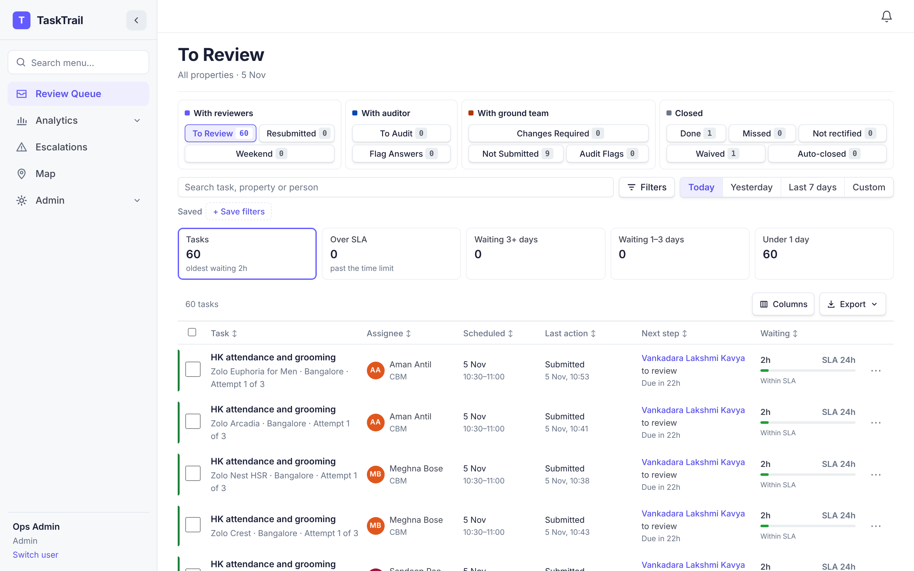
      <p><b>Review queue</b><br /><sub>Every task grouped by who acts next, with waiting time against SLA, bulk remind and reassign, and saved filters.</sub></p>
    </td>
    <td width="50%" valign="top">
      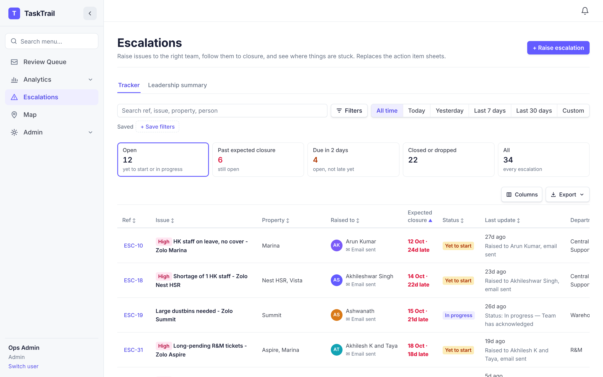
      <p><b>Escalations</b><br /><sub>Blockers raised to a department, with an owner, expected closure, updates and a leadership summary.</sub></p>
    </td>
  </tr>
</table>

<details>
<summary><b>More screens</b></summary>
<br />

<table>
  <tr>
    <td width="50%" valign="top">
      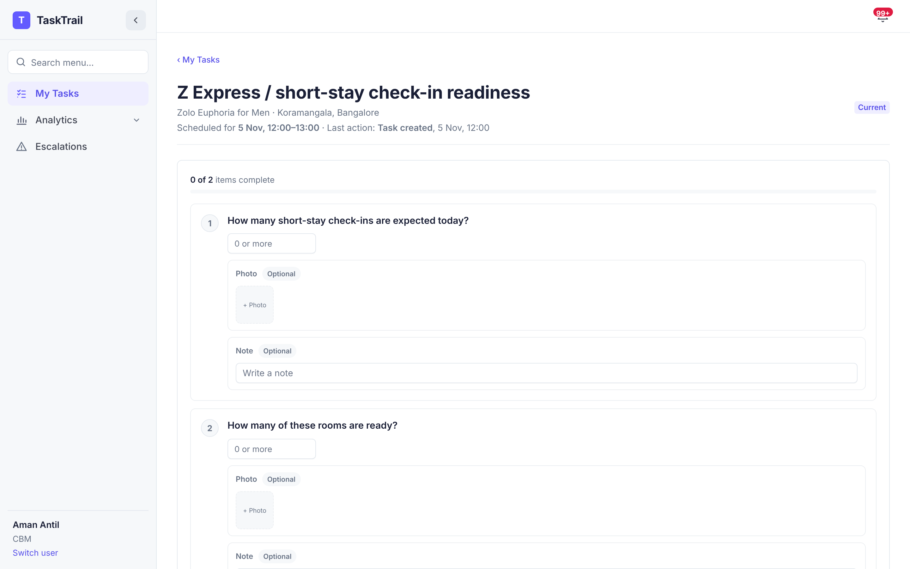
      <p><b>Checklist</b><br /><sub>Each item can require a photo, a note or a specific answer.</sub></p>
    </td>
    <td width="50%" valign="top">
      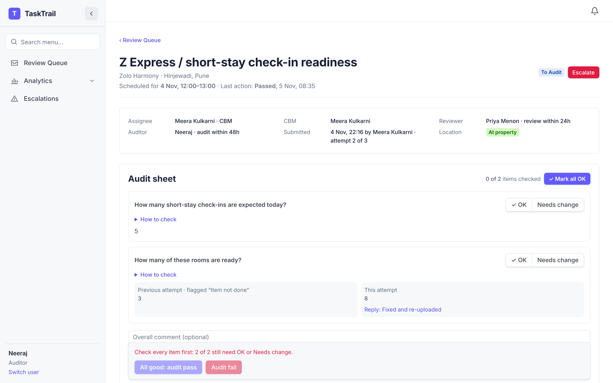
      <p><b>Audit sheet</b><br /><sub>The auditor sees every attempt and passes or fails the sample.</sub></p>
    </td>
  </tr>
  <tr>
    <td width="50%" valign="top">
      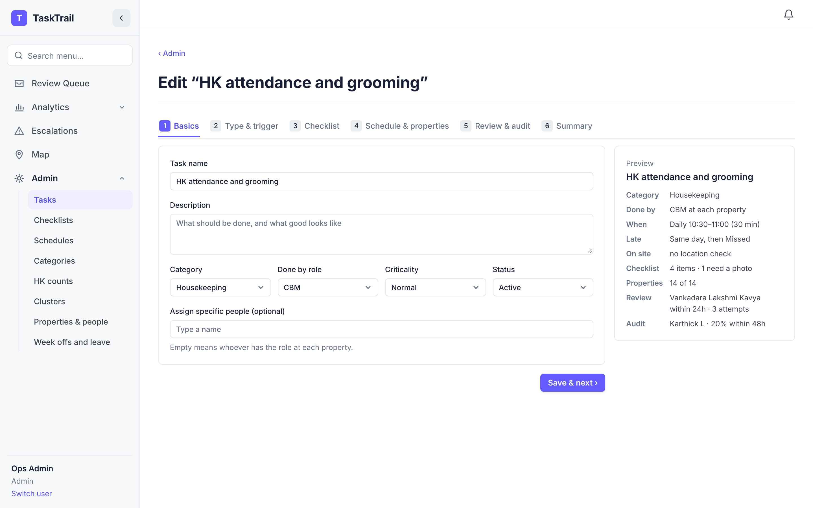
      <p><b>Task setup</b><br /><sub>A six-step wizard: basics, trigger, checklist, schedule and properties, review and audit, summary.</sub></p>
    </td>
    <td width="50%" valign="top">
      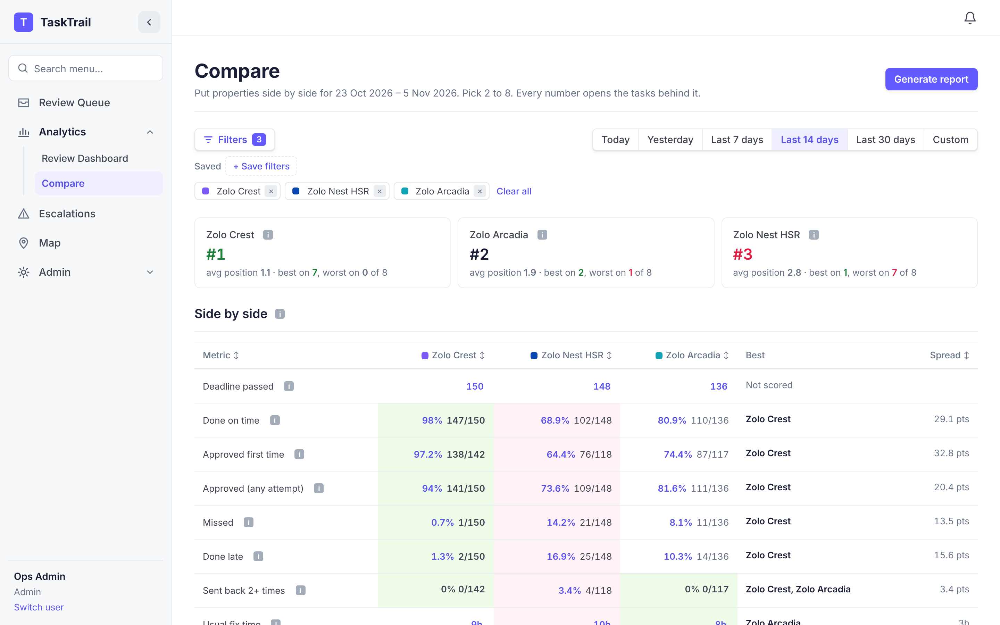
      <p><b>Compare</b><br /><sub>Two to eight properties, clusters, cities or people ranked side by side.</sub></p>
    </td>
  </tr>
  <tr>
    <td width="50%" valign="top">
      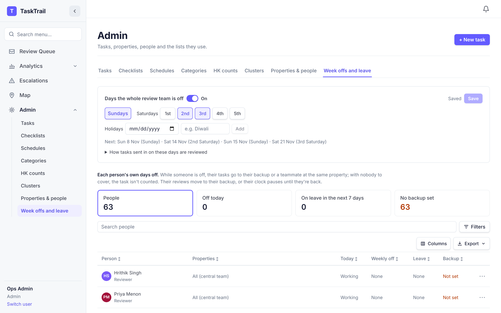
      <p><b>Week offs and leave</b><br /><sub>Review-team off days, holidays, personal week offs, leave and backups.</sub></p>
    </td>
    <td width="50%" valign="top">
      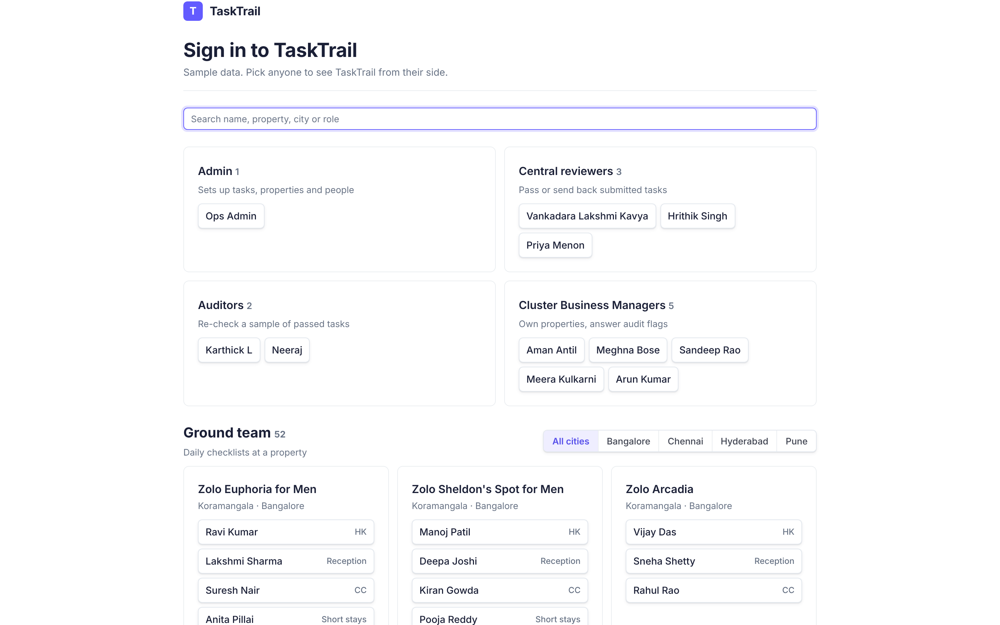
      <p><b>Sign-in</b><br /><sub>Pick anyone from the sample data to see TaskTrail from their side.</sub></p>
    </td>
  </tr>
</table>

</details>

## Key features

<table>
  <tr>
    <td width="33%" valign="top">
      <h4>Task setup</h4>
      Scheduled (daily, weekly, monthly, once), event-triggered and on-demand tasks. Checklist items can be a tick, yes/no, choice, number, count or text, each with its own photo and note rules and a reviewer guide.
    </td>
    <td width="33%" valign="top">
      <h4>Field execution</h4>
      Start and stop timing, up to 10 photos per item (shrunk in the browser before upload), notes, and a location check worked out on the server against each property's geofence.
    </td>
    <td width="33%" valign="top">
      <h4>Central review</h4>
      Item-by-item OK or Needs change with structured reasons. A pass is blocked while mandatory evidence is missing. The submitter can't review their own work, and the reviewer can't audit it.
    </td>
  </tr>
  <tr>
    <td width="33%" valign="top">
      <h4>Rework loop</h4>
      Flagged tasks go back to the doer with the reason. Attempts are counted against the task's limit, and a task that runs out of attempts is marked "Not rectified".
    </td>
    <td width="33%" valign="top">
      <h4>Audit sampling</h4>
      A set share of passed tasks (the task's audit rate) is sampled for audit. A failed audit needs an answer from the CBM, which the auditor closes or sends back.
    </td>
    <td width="33%" valign="top">
      <h4>Full history</h4>
      Every action is logged on the task with the person and the time, including durations between steps, reminders, reassignments and escalations.
    </td>
  </tr>
  <tr>
    <td width="33%" valign="top">
      <h4>Escalations</h4>
      Raised in three steps (issue, department, urgency) to R&amp;M, HK &amp; Facilities, Warehouse, Sourcing or Central Support. A ready-to-send email draft opens in the mail app.
    </td>
    <td width="33%" valign="top">
      <h4>Off days and cover</h4>
      Personal week offs, leave and backups move work to cover. Reviewers see who's off at their properties on a read-only Team availability page. Review-team off days pause SLA clocks, and tasks submitted on them are sampled or close themselves.
    </td>
    <td width="33%" valign="top">
      <h4>Notifications</h4>
      An in-app bell with pop-ups for send-backs, audit flags, reminders, assignments and escalations.
    </td>
  </tr>
</table>

Every table shares one toolkit: choose columns, export to **Excel or CSV**, page size, and row actions. Filters can be saved per screen with a default view. Admins can also upload cluster and property sheets (`.xlsx` or CSV), and everyone can see properties on the map.

## How it works

### Task lifecycle

Each task moves through these statuses (`lib/statuses.ts`, rules in `lib/engine.ts`):

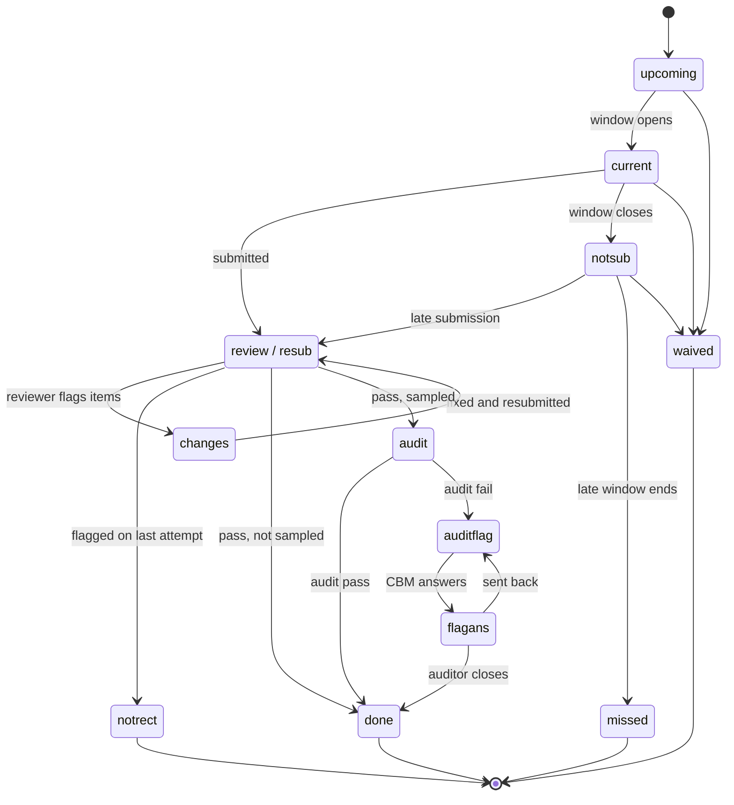

Waived tasks are left out of every rate. Time-based moves (window closing, missed, weekend auto-close, leave cover) run in `sweep()` on page load, which also generates today's and tomorrow's scheduled tasks.

### Who does what

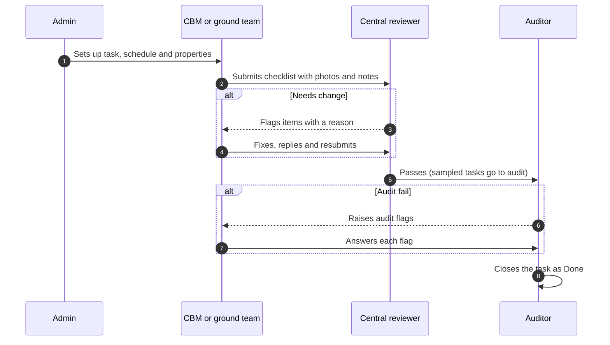

### Escalations

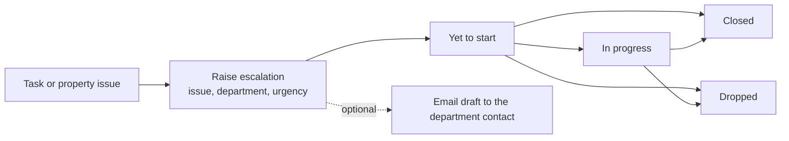

Each escalation gets a reference (`ESC-n`), an expected closure date from its priority (high 1 day, medium 3, low 7), linked properties and task, photos, and a dated update log. Raising one from a task adds it to the task's history.

## Dashboards and reporting

The **Review Dashboard** (operations command center) is scoped to the viewer's properties and can be filtered by city, cluster, property and date range (today to 30 days, or custom), with comparison against the previous period.

| Area | What it shows |
|---|---|
| **Ground team** | Every figure counts only tasks past their deadline: count, completed, completed on time (target 85%+), passed first attempt (target 80%+), missed (target under 5%), done late, sent back for fixes |
| **Reviewers** | Tasks to review and reviewed, reviewed on time (target 90%+), reviews missed (target under 2%), waiting too long |
| **Outcome** | How every task past its deadline ended |
| **Action required** | Issues ranked by severity and age, each with an owner |
| **Why it's happening** | Breakdown of send-back reasons |
| **Who's accountable** | Property, reviewer and CBM tables with daily trends |

Every figure opens the list of tasks behind it. **Compare** ranks two to eight properties, clusters, cities, CBMs, assignees or reviewers side by side and generates a printable report. The **Escalations** leadership summary shows open, overdue, raised and closed counts and the usual time to close.

## Roles and permissions

| Role | Sees | Can do |
|---|---|---|
| **Ground team** | My Tasks, Map | Fill checklists, upload photos, check location, resubmit flagged items |
| **CBM** | My Tasks, Analytics, Escalations, Map | Everything above for their properties, answer audit flags, waive tasks, raise escalations |
| **Central reviewer** | Review Queue, Analytics, Escalations, Map, Team availability | Pass or flag with reasons, reopen, reassign, remind, and see (read-only) week offs and leave of everyone at their clusters' properties |
| **Auditor** | Review Queue (To Audit, Flag Answers), Analytics, Escalations, Map | Audit pass or fail, close or return flag answers |
| **Admin** | Everything, plus Admin | Upload map locations, task setup, event triggers, checklists, schedules, categories, clusters, properties and people, week offs and leave |

CBMs and ground staff only see their own properties. Server actions check scope again before every change (`lib/auth.ts`).

## Tech stack

| Layer | Technology |
|---|---|
| **Framework** | [Next.js 15](https://nextjs.org) App Router with React Server Components and Server Actions |
| **UI** | React 19, TypeScript 5.9, hand-written CSS with design tokens ([`DESIGN.md`](DESIGN.md)), Inter |
| **Database** | SQLite through [libSQL](https://github.com/tursodatabase/libsql): a local file in development, [Turso](https://turso.tech) in production |
| **File storage** | [Vercel Blob](https://vercel.com/docs/storage/vercel-blob) when connected, otherwise the database or `data/uploads` |
| **Maps** | [Leaflet](https://leafletjs.com) with marker clustering |
| **Spreadsheets** | Built-in `.xlsx` reader and writer (no library) |
| **Testing** | `node:test` with esbuild bundling |
| **Hosting** | [Vercel](https://vercel.com), pinned to Mumbai (`bom1`) |
| **Browser build** | [sql.js](https://sql.js.org) for a single-file, in-memory version |

There is no separate API layer: pages read data in server components and change it through server actions. The only routes are photo upload and download (`app/api/upload`, `app/api/files/[name]`).

## Architecture

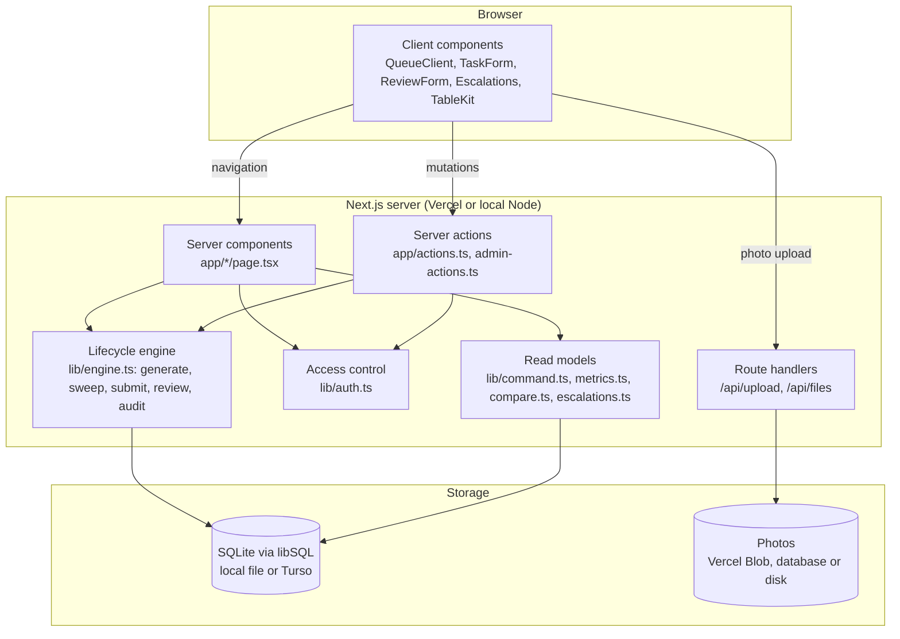

- **Pages** call `boot()` first. It runs the time-based `sweep()` and resolves the signed-in person, so task states are always current without a background job.
- **Server actions** check the person's role and property scope, then call the engine inside a transaction.
- **Dates and times** are India Standard Time wherever the server runs (`lib/time.ts`).
- **First run**: `instrumentation.ts` opens the database at server start, creates the tables from `lib/schema.sql` and seeds sample data when they are empty.

## Getting started

### Prerequisites

- Node.js 20 or newer
- npm

### Run locally

```bash
git clone https://github.com/until-aman/zotask.git
cd zotask
npm install
npm run dev
```

Open http://localhost:3000 and pick anyone on the sign-in page. The database is created and seeded on first load in `data/tasktrail.db`, with 4 cities, 7 clusters, 14 properties, 63 people, 13 task types and 14 days of simulated history.

| Command | What it does |
|---|---|
| `npm run dev` | Development server on port 3000 |
| `npm run build` | Production build |
| `npm start` | Serve the production build (uses `$PORT`, default 3000) |
| `npm test` | Run the test suite |
| `npm run reset` | Delete `data/` so the next start seeds fresh data from today |
| `node web/build.mjs` | Build `web/dist/tasktrail.html`, a single-file in-browser version |

### Environment variables

None are needed locally. For production, copy [`.env.example`](.env.example) to `.env.local` or set them in your host:

```bash
# Hosted database (Turso). Leave unset to use the local SQLite file in data/.
TURSO_DATABASE_URL=
TURSO_AUTH_TOKEN=

# Photo storage (Vercel Blob). Leave unset to store photos in the database (Turso) or data/uploads (local).
BLOB_READ_WRITE_TOKEN=
```

`DATABASE_URL` is also accepted in place of `TURSO_DATABASE_URL`.

## Deployment

TaskTrail runs on Vercel and Turso free plans.

1. Import the repository in Vercel (**Add New → Project**). No build settings need changing.
2. In **Storage**, create a **Turso** database (region Mumbai) and connect it. This adds `TURSO_DATABASE_URL` and `TURSO_AUTH_TOKEN`.
3. In **Storage**, create a **Blob** store and connect it. This adds `BLOB_READ_WRITE_TOKEN`.
4. Redeploy. The first visit creates the tables and loads the sample data.

`vercel.json` pins functions to Mumbai (`bom1`) to sit next to a Mumbai database. Photos are shrunk in the browser to stay under Vercel's 4.5 MB request limit.

## Project structure

```text
.
├── app/                    Pages, server actions and route handlers (Next.js App Router)
│   ├── actions.ts          Task, review, audit, escalation and leave actions
│   ├── admin-actions.ts    Admin setup actions
│   ├── tasks/              My Tasks and the checklist form
│   ├── queue/              Review queue
│   ├── review/[id]/        Review and audit sheet
│   ├── dashboard/          Operations command center
│   ├── compare/            Side-by-side comparison report
│   ├── escalations/        Escalation tracker and summary
│   ├── map/                Property map
│   ├── admin/              Task setup, libraries, clusters, people, week offs
│   └── api/                Photo upload and download
├── components/             Client components
│   ├── cc/                 Command center dashboard
│   ├── esc/                Escalations
│   ├── admin/              Admin screens
│   ├── map/                Leaflet map
│   └── ui/                 Shared table toolkit, filters, inputs
├── lib/                    Server logic
│   ├── schema.sql          Database schema
│   ├── db.ts               libSQL access, transactions, first-run seeding
│   ├── engine.ts           Task lifecycle rules
│   ├── auth.ts             Sign-in cookie, roles and property scope
│   ├── command.ts          Dashboard figures with the task ids behind them
│   ├── escalations.ts      Escalation data and rules
│   ├── offdays.ts          Review-team off days and SLA pauses
│   ├── seed.ts             Sample data and history simulation
│   └── time.ts             IST date and time helpers
├── tests/                  node:test suites and the test runner
├── web/                    Single-file browser build (sql.js)
├── docs/images/            README screenshots
├── DESIGN.md               Design tokens and component rules
└── vercel.json             Deployment region
```

## Testing

```bash
npm test
```

Each test file is bundled with esbuild and runs against its own freshly seeded database with the clock on UTC (as on Vercel), calling the real server actions as different people. The suites cover the review and audit workflow, permissions, notifications, week offs and leave, team cover, task properties, templates, clusters, time handling, unassigning and escalation clean-up. Run one suite with `npm test -- workflow`.

## Known limitations

- **No real authentication.** The sign-in page lets anyone choose any person. A `uid` cookie holds the choice.
- **In-app notifications only.** No email, SMS or WhatsApp is sent. Escalation emails are drafts opened in the person's mail app.
- **No booking-system integration.** Event-triggered tasks are started by an admin.
- **Location checks** are worked out on the server from the phone's coordinates, and haven't been field-tested on phones at properties.
- **Sample data.** The seed uses sample properties, people and history. Clear it before real use.
- **Single region, single database.** No load or security testing has been done.

## Roadmap

| Status | Item |
|---|---|
| Done | Scheduled, event and on-demand tasks with a six-step setup wizard |
| Done | Review, rework, audit sampling and audit flag loop |
| Done | Operations command center, comparison report, Excel and CSV export |
| Done | Escalations with tracker and leadership summary |
| Done | Week offs, leave, backups and review-team off days |
| Done | In-app notifications |
| Not started | Company sign-in with roles |
| Not started | Email or WhatsApp notifications |
| Not started | Booking-system link for event tasks |
| Not started | Field testing on phones, multi-day SLA runs, security review and load test |

The "Not started" items are the known gaps above, not committed plans.

## License

This repository does not include a license file yet. All rights are reserved by the owner until one is added.

<div align="center">
<br />
<sub>Built with Next.js, React and SQLite · Design notes in <a href="DESIGN.md">DESIGN.md</a></sub>
</div>
